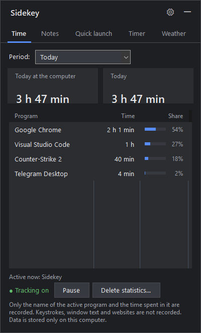
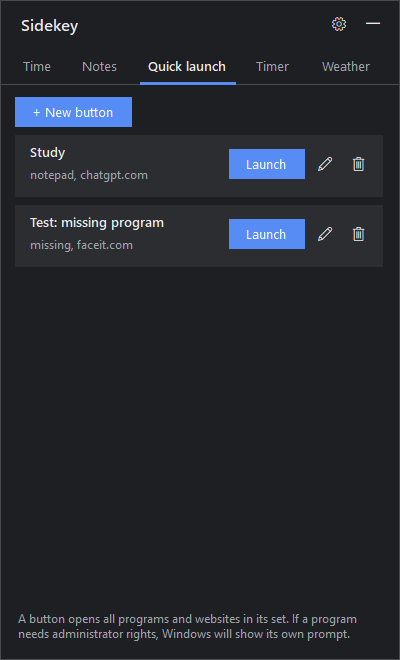
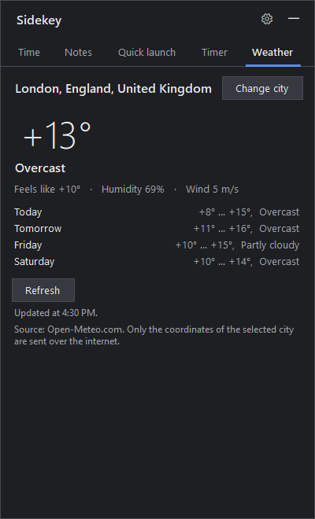

# Sidekey

**A tiny side panel for Windows that opens with a keyboard shortcut.**
Time tracking, notes, quick-launch buttons, a timer, the weather, a volume mixer and a music player — in one `.exe` under 400 KB
that needs no installation and uses about 30 MB of RAM.

[Русская версия](README.ru.md)

<p>
  
  
  
</p>

## Features

- **Time** — how long you've been at the computer today or in any period, and which programs you used
  (time and share). Idle time and the lock screen are not counted. Tracking can be paused, and statistics deleted.
- **Notes** — quick notes that save automatically.
- **Quick launch** — your own buttons that open a set of programs and websites in one click.
  Each item can have a delay (e.g. start an anti-cheat, wait 30 s, then start the game),
  and each button can have its own **global shortcut** that works even when the panel is hidden.
- **Timer** — timer with a sound and a Windows notification, a stopwatch with laps, and a calculator.
- **Weather** — current weather and a 4-day forecast for your city
  (via [Open-Meteo](https://open-meteo.com), no API key needed).
- **Volume** — system volume and per-app volume, mute any app with one click.
- **Player** — a lock-screen-style player with a big cover, seeking, shuffle and repeat:
  **Now playing** controls whatever is playing in Windows (Spotify, YouTube in a browser, other players) — no sign-in;
  **My tracks** plays mp3, m4a, flac, wav and wma files from a folder you choose.
- **10 languages** — English, 中文, हिन्दी, Español, Français, العربية, বাংলা, Português, Русский, Deutsch.
- Five themes (dark, light, dark blue, dark red, dark green). Opens at the right edge of the screen with **Ctrl + Alt + T**
  (configurable); unlock the panel to move it anywhere and resize it a little (−10 % … +20 %). Lives in the tray.

## Privacy

- Only the **name of the active program** and the time spent in it are recorded.
  No keystrokes, window titles, screen contents or browsing history.
- All data stays on your computer in `%LOCALAPPDATA%\Sidekey\data` (plain JSON files).
- The only network requests go to Open-Meteo: the city name when you search for it, then its coordinates.
- The Player tab works locally: it talks to the app that is playing through Windows and plays files from the folder
  you choose. It needs no account and sends nothing over the internet; only the folder path is saved in the settings.

## Install

1. Download `Sidekey.exe` from [Releases](../../releases) and put it in any folder.
2. Run it. Windows SmartScreen may warn about an unknown publisher (the file is not code-signed):
   click **More info → Run anyway**, or build it yourself from source (see below).
3. Press **Ctrl + Alt + T** to open the panel. Optional: enable *Start with Windows* in Settings.

Requirements: Windows 10 (version 1809 or newer) or 11 — uses .NET Framework 4.8, which is already part of Windows.

## Build from source

No SDK or IDE needed — the C# compiler that ships with Windows is enough:

```
build.cmd
```

This produces `Sidekey.exe`. Self-test with sample data (nothing is launched; writes `report.txt` and screenshots):

```
Sidekey.exe --selftest C:\path\to\empty\folder
```

Other options: `--hidden` (start in the tray), `--data <folder>` (use another data folder).

## Translations

Strings live in [`lang/<code>.json`](lang) and are embedded into the `.exe` at build time.
To fix or add a language, copy `lang/en.json`, translate the values (keep the keys and `{0}`, `{1}` placeholders),
and add the language to `Languages` in [`src/Lang.cs`](src/Lang.cs). The self-test checks that every
translation has all strings. Hindi, Bengali and Arabic would especially benefit from a native speaker's review.
Arabic is translated, but the layout is not mirrored (right-to-left) yet.

## Similar tools

Sidekey is a lightweight all-in-one. If you need more depth in one area, look at
[ActivityWatch](https://activitywatch.net) (detailed time tracking) or
[PowerToys Workspaces](https://learn.microsoft.com/windows/powertoys/workspaces) (launching app layouts).

## License

[MIT](LICENSE)
