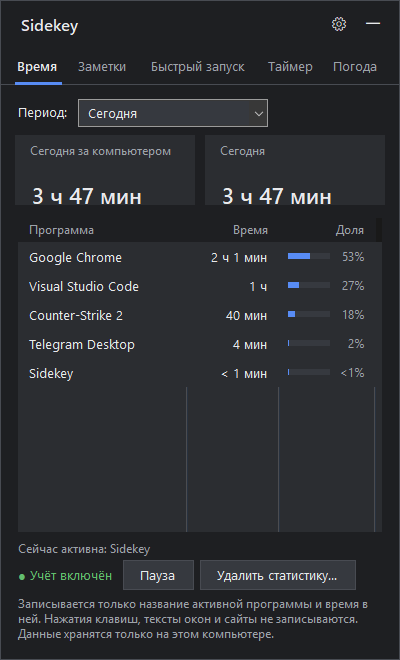
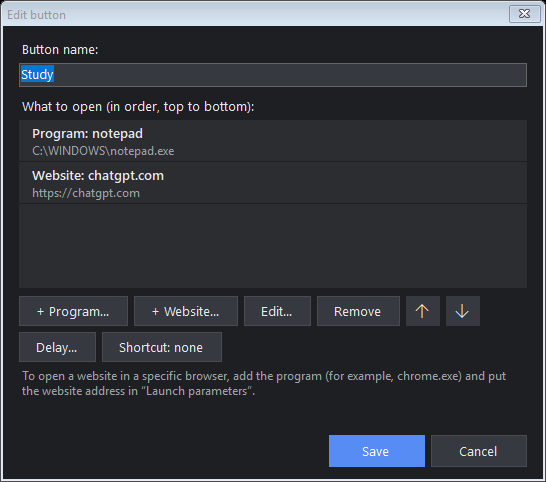

# Sidekey

**Маленькая боковая панель для Windows, которая открывается сочетанием клавиш.**
Учёт времени, заметки, кнопки быстрого запуска, таймер, погода, микшер громкости и музыкальный плеер — в одном `.exe` меньше 400 КБ,
без установки, около 30 МБ памяти.

[English version](README.md)

  
  

## Возможности

- **Время** — сколько вы за компьютером сегодня и за любой период, в каких программах (время и доля).
  Бездействие и экран блокировки не считаются. Учёт можно приостановить, статистику — удалить.
- **Заметки** — быстрые заметки с автосохранением.
- **Быстрый запуск** — свои кнопки, которые открывают набор программ и сайтов одним нажатием.
  У каждого пункта может быть задержка (например, античит → подождать 30 с → игра),
  а у каждой кнопки — своё **глобальное сочетание клавиш**, которое работает, даже когда панель скрыта.
- **Таймер** — таймер со звуком и уведомлением Windows, секундомер с кругами и калькулятор.
- **Погода** — текущая погода и прогноз на 4 дня ([Open-Meteo](https://open-meteo.com), без ключа).
- **Звук** — общая громкость системы и громкость каждой программы, отключение звука одним нажатием.
- **Плеер** — плеер как на экране блокировки: большая обложка, перемотка, случайный порядок и повтор.
  **Сейчас играет** управляет тем, что играет в Windows (Spotify, YouTube в браузере, другие плееры), без входа;
  **Мои треки** играет mp3, m4a, flac, wav и wma из выбранной папки.
- **10 языков** и пять тем (тёмная, светлая, тёмно-синяя, тёмно-красная, тёмно-зелёная). Панель открывается у правого края
  по **Ctrl + Alt + T** (можно изменить); если открыть замок, её можно перенести куда угодно и немного изменить размер
  (от −10 % до +20 %). Значок в трее.

## Приватность

- Записывается только **название активной программы** и время в ней. Нажатия клавиш, заголовки окон,
  содержимое экрана и история браузера не записываются.
- Все данные хранятся на компьютере в `%LOCALAPPDATA%\Sidekey\data` (обычные JSON-файлы).
- В интернет уходит только запрос погоды в Open-Meteo: название города при поиске, затем его координаты.
- Вкладка «Плеер» работает локально: с программой, которая играет, она общается через Windows, а файлы играет
  из выбранной вами папки. Аккаунт не нужен, в интернет ничего не уходит; в настройках сохраняется только путь к папке.

## Установка

1. Скачайте `Sidekey.exe` из раздела [Releases](../../releases) и положите в любую папку.
2. Запустите. Windows SmartScreen может предупредить о неизвестном издателе (файл не подписан):
   «Подробнее → Выполнить в любом случае», либо соберите программу сами из исходников.
3. Нажмите **Ctrl + Alt + T**. При желании включите в настройках «Запускать вместе с Windows».

Нужна Windows 10 (версии 1809 или новее) или 11 — используется .NET Framework 4.8, он уже есть в Windows.

## Сборка из исходников

Ничего устанавливать не нужно — хватает компилятора C#, встроенного в Windows: запустите `build.cmd`.
Самопроверка на тестовых данных (ничего не запускает, пишет `report.txt` и снимки окон):
`Sidekey.exe --selftest C:\путь\к\пустой\папке`.

Ключи: `--hidden` (запуск в трей), `--data <папка>` (другая папка данных).

## Переводы

Тексты лежат в `lang/<код>.json` и встраиваются в `.exe` при сборке. Чтобы добавить язык, скопируйте
`lang/en.json`, переведите значения (ключи и `{0}`, `{1}` не трогайте) и добавьте язык в `Languages`
в `src/Lang.cs`. Арабский переведён, но разметка окна пока не зеркальная (справа налево).

## Лицензия

[MIT](LICENSE)
